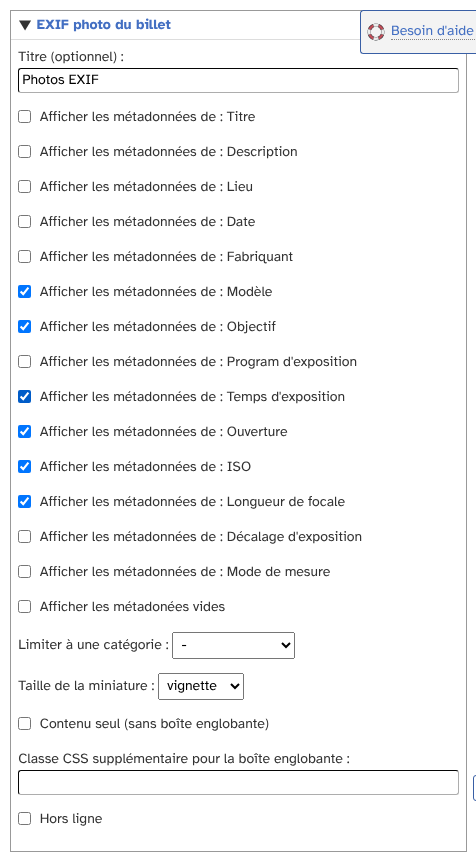
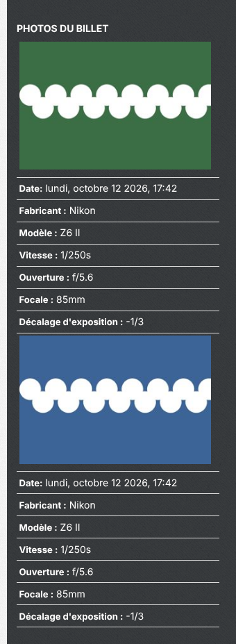

# Entry Photo EXIF Widget : guide d'utilisation

Entry Photo EXIF Widget ajoute un widget qui affiche les données EXIF (appareil, objectif, ouverture, vitesse…) des photos du billet que le visiteur est en train de lire. Le widget lit les images du billet, retrouve leurs fichiers dans le dossier public du blog et affiche les informations que vous avez choisies, avec une miniature.

Ce plugin n'a pas de page d'administration : tout se règle dans les réglages du widget.

## Sommaire

1. [Ce qu'il faut avant de commencer](#ce-quil-faut-avant-de-commencer)
2. [Ajouter le widget](#ajouter-le-widget)
3. [Les réglages du widget](#les-réglages-du-widget)
4. [Ce que voient les visiteurs](#ce-que-voient-les-visiteurs)
5. [Quand le widget est caché](#quand-le-widget-est-caché)
6. [Bon à savoir](#bon-à-savoir)

## Ce qu'il faut avant de commencer

* Les photos doivent être des images du blog (gérées par le gestionnaire de médias) insérées dans le billet, en JPEG, PNG ou GIF. Seuls les fichiers JPEG contiennent normalement des données EXIF.
* L'extension PHP « exif » doit être active sur le serveur.
* Il faut avoir le droit de gérer les widgets.

## Ajouter le widget

1. Allez dans **Système > Widgets**.
2. Dans la liste des widgets disponibles, choisissez **EXIF photo du billet** et ajoutez-le dans une zone (par exemple **Extra**).
3. Ouvrez le widget pour le régler, puis enregistrez.

## Les réglages du widget

* **Titre (optionnel)** : le titre affiché au-dessus du widget.
* **Afficher les métadonnées de…** : une case par information. Cochées par défaut : **Modèle**, **Objectif**, **Temps d'exposition**, **Ouverture**, **ISO** et **Longueur de focale**. Les autres choix : **Titre**, **Description**, **Lieu**, **Date**, **Fabricant**, **Programme d'exposition**, **Décalage d'exposition** et **Mode de mesure**.
* **Afficher les métadonnées vides** : affiche aussi les lignes dont la valeur est vide.
* **Limiter à une catégorie** : le widget n'apparaît que sur les billets de cette catégorie. **Sans catégorie** le limite aux billets sans catégorie, et **-** (le choix par défaut) ne limite pas.
* **Taille de la miniature** : **Aucun**, **carrée**, **vignette**, **petite** ou **moyenne**. La miniature n'est affichée que si le gestionnaire de médias l'a créée.
* **Contenu seul (sans boîte englobante)**, **Classe CSS supplémentaire** et **Hors ligne** : réglages habituels des widgets.

## Ce que voient les visiteurs

Sur la page d'un billet, le widget affiche pour chaque photo du billet : sa miniature, puis une ligne par information choisie.

Le widget n'apparaît que sur les pages de billets (billets, pages, et galeries du plugin Gallery). Il n'a rien à afficher sur l'accueil ou sur les listes.

Une même photo placée plusieurs fois dans un billet n'est listée qu'une seule fois.

## Quand le widget est caché

Le widget ne s'affiche pas si :

* le billet ne contient aucune photo du blog ;
* aucune information cochée n'est disponible pour la photo (par exemple une image sans EXIF) ;
* le billet n'est pas dans la catégorie choisie ;
* le widget est **Hors ligne**.

## Bon à savoir

* **ISO, programme d'exposition et mode de mesure ne s'affichent jamais** avec des photos d'appareil ordinaires : ces valeurs sont des nombres dans le fichier, et le plugin ne reconnaît que des textes. Les cases existent mais restent sans effet.
* **L'heure de prise de vue est décalée** : l'heure du fichier est celle de l'appareil, mais le plugin la convertit comme si elle était en heure universelle. Avec un blog en heure de Paris, une photo prise à 15 h 42 s'affiche à 17 h 42 (en été).
* **L'objectif** n'est lu que s'il est présent dans les métadonnées XMP de la photo : il manque pour beaucoup d'appareils.
* **Le titre, la description et le lieu** viennent des métadonnées IPTC/XMP (un logiciel de photo les renseigne). La description n'apparaît que si le titre existe et qu'il est différent.
* **Si une photo n'a aucune information à montrer, tout le widget disparaît**, même si les autres photos du billet en ont. Pour les billets mélangeant photos avec et sans EXIF, le résultat peut être surprenant.
* **Fautes dans les textes** : « Descritpion », « Focal lengh », « Portait mode », « Unknow », « Program d'exposition » et « métadonées vides ».
* **Chemin des images** : seules les images dont l'adresse commence par l'adresse publique du blog sont lues. Les images hébergées ailleurs sont ignorées.
